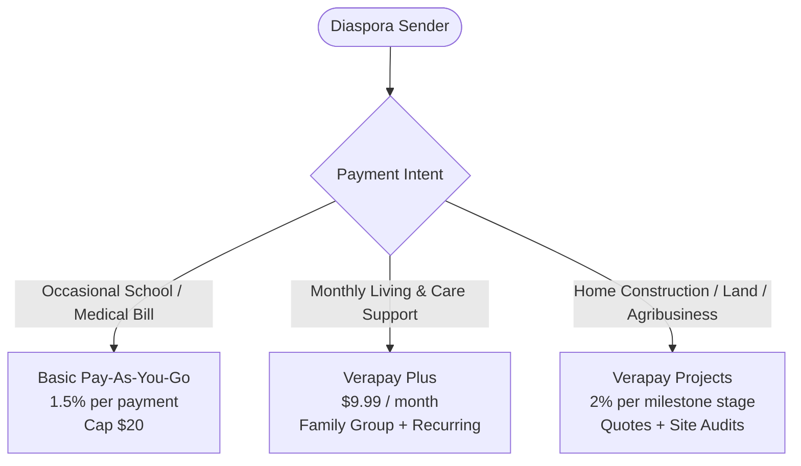
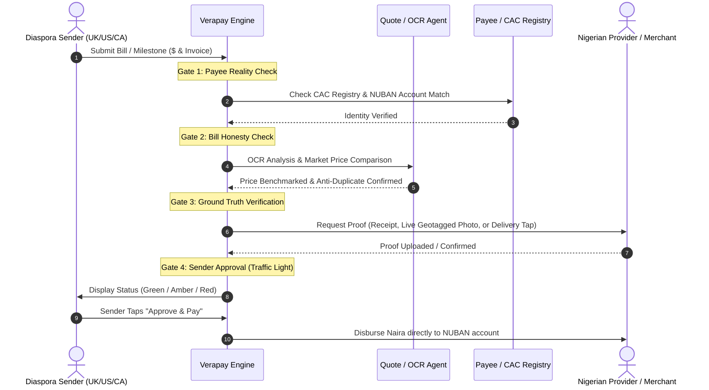
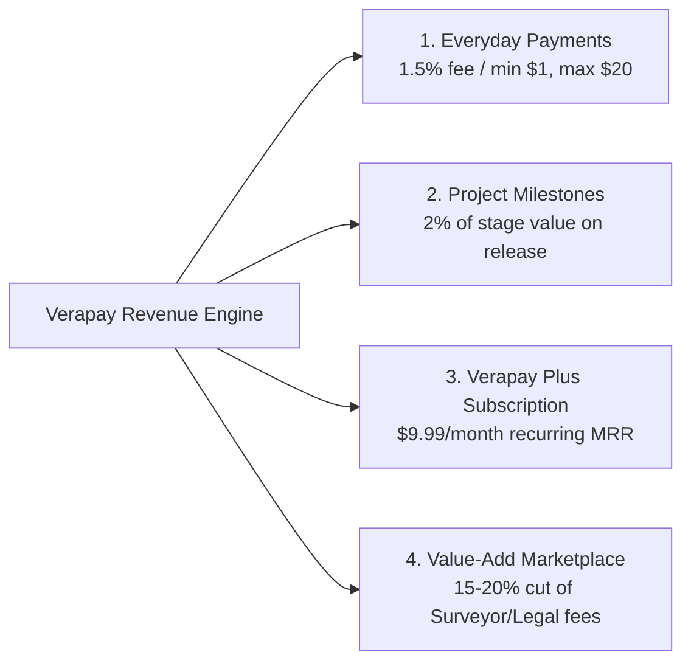

# Verapay: Verify, Then Release
**Product Requirements Document (PRD) | Version 2.0 (Hackathon & Production Roadmap)**

---

## Executive Summary

| Attribute | Details |
| :--- | :--- |
| **Product Name** | **Verapay** (*"Verify, then release."*) |
| **Mission** | Eliminating remittance fraud and diversion by providing AI-verified, milestone-gated, sender-approved payments directly to Nigerian providers. |
| **Target Users** | Nigerian diaspora in the UK, US, and Canada sending recurring family support or funding capital projects (construction, land, agribusiness) back home. |
| **Funding Rails** | PayPal Checkout (Sandbox for Hackathon / Production API for Global Senders). |
| **Payout Rails** | Licensed Nigerian Payment Service Provider (Paystack / Flutterwave) for direct NUBAN Naira settlement. |
| **Status** | Version 2.0 Expanded Specification (Hackathon Demo & Commercial Architecture). |

---

## 1. Core Principles & Philosophy

1. **Pay the provider, not an informal go-between:** Funds go directly to verified schools, hospitals, landlords, or material merchants—never handed over as unmonitored cash to relatives or intermediaries.
2. **Proof before release:** Invoices, receipts, CAC business registrations, live geolocated photos, and delivery confirmations are rigorously validated before a single cent moves.
3. **The sender always decides:** AI acts as a forensic risk analyst, never as an autonomous bank teller. AI presents an actionable traffic-light summary (**Green / Amber / Red**); the sender retains final approval or refund power.
4. **Equal security for all (The Golden Rule):** Everyone gets the same institutional-grade fraud checks, whether on the free tier or a paid subscription. **Premium never buys weaker checks or bypasses verification; it buys convenience, family group collaboration, recurring automation, and rapid human escalation.**
5. **Aligned incentives:** Verapay only earns when money is safely and legitimately released to the provider. If proof fails, fraud is caught, and funds are refunded, Verapay takes $0.

---

## 2. Problem Statement & Market Reality

Every year, the Nigerian diaspora remits approximately **\$20 billion** back home. However, traditional remittances suffer from catastrophic visibility failure once money crosses borders:

| Failure Mode | How It Happens in Reality | Verapay Solution |
| :--- | :--- | :--- |
| **Diversion** | Funds intended for a mother’s surgery or a house foundation are redirected to personal consumption by family members or contractors. | Direct-to-provider settlement; money never touches informal hands. |
| **Contractor Extortion & Stalls** | Contractors demand lump sums upfront, slow down, send recycled photos, or abandon the site mid-way. | Milestone escrow: funds release stage-by-stage (foundation, lintel, roof, finishes) only after forensic proof. |
| **Padded Material Costs** | Contractors inflate market prices (e.g., claiming cement is ₦14,500/bag when wholesale is ₦10,500) and pocket the margin. | Autonomous **Quote Agent** samples 2–3 regional suppliers to flag price padding. |
| **AI-Faked Proof & Receipts** | Generative AI and image editors create convincing fake invoices and reused construction images. | Forensic perceptual hashing, EXIF location/time verification, and live in-app camera capture. |
| **Irreversible Bank Transfers** | Once Naira lands in a Nigerian commercial bank account via NIBSS, chargebacks and fraud recalls are practically impossible. | Pre-funding escrow: sender deposits into secure escrow; funds only enter local banking upon verified release. |

---

## 3. Product Architecture & User Plans

Verapay structures its offering into three distinct tiers tailored to sender behaviors, ensuring steady recurring revenue while serving one-off needs.



### Plan Comparison Matrix

| Feature | Basic | Verapay Plus | Verapay Projects |
| :--- | :--- | :--- | :--- |
| **Target User** | Occasional senders (termly fees, emergency medical) | Regular family providers (monthly rent, allowance, groceries) | Diaspora building homes, buying land, running farms |
| **Pricing** | **1.5% per payment**<br>*(Min \$1, Max \$20, \$0/month)* | **\$9.99 / month**<br>*(0% fee up to \$1,000/mo, 1.5% thereafter)* | **2% per stage**<br>*(Charged strictly when stage is approved)* |
| **Verification Level** | Full 4-Step Forensic Check | Full 4-Step Forensic Check | Full 4-Step + Physical/Video Stage Audits |
| **Scheduled / Auto-Pay** | Manual per payment | **Automated monthly recurring** with bill re-verification | Milestone-triggered |
| **Family Group Account** | Single user | **Multi-user family portal** (abroad siblings + home relatives) | Multi-stakeholder project portal |
| **Shared Pot / Split Bills** | ❌ | **Yes** (siblings pool funds for one major bill) | Co-investor milestone funding |
| **Human Escalation** | Standard review queue | **Priority review within hours** on Amber flags | Dedicated project dispute mediation |
| **Reporting** | Per-transaction receipt | **Monthly consolidated 1-page financial audit** | **Weekly plain-English progress digest** |
| **Specialized Tools** | Standard invoice verification | Shared ledger & receipt archive | **AI Quote Agent** + Live surprise 15s video |
| **Third-Party Services** | ❌ | ❌ | Optional certified surveyor site inspection |

---

## 4. In-Depth Plan Breakdown

### 4.1. Basic (Pay-As-You-Go)
* **Ideal for:** Sending money 1–3 times a year (e.g., paying Aunty Bola’s hospital bill or niece Ada’s school fees once per term).
* **Cost:** 1.5% fee on verified payout (\$1 floor, \$20 ceiling).
* **Example:** Tunde pays Ada's \$400 school fee. Verapay adds a \$6 fee. Tunde pays \$406 via PayPal; Bright Future School receives the full \$400 in Naira.

### 4.2. Verapay Plus (Family Subscription)
* **Ideal for:** Families sending steady monthly remittances to parents and dependents.
* **Cost:** \$9.99/month flat fee.
* **Key Capabilities:**
  1. **Automated Monthly Payments:** Schedule monthly rent, medical stipends, or grocery allowances. Verapay validates each recurring invoice/account before releasing.
  2. **Family Group Workspace:** Brothers and sisters across London, Toronto, and Atlanta join a single shared workspace alongside family back in Nigeria. All members see real-time payment status and audited receipts.
  3. **Shared Pot (Split-Pay):** When an elder requires a major medical procedure (e.g., \$1,500 surgery), siblings chip in their respective shares into a single protected pot. Verapay disburses directly to the hospital once fully funded.
  4. **Expedited Human Escalation:** If AI flags an anomaly (Amber alert), an in-house human analyst examines the document within 2–4 hours.
  5. **Monthly Executive Digest:** A consolidated one-page financial report detailing total spend, provider receipts, and verified proof for household accountability.
* **The Business Case (Why Tunde Switches):**
  * Tunde in Manchester sends \$800/month for his parents' rent and sustenance.
  * On Basic, fees would be 1.5% of \$800 = **\$12.00/month**.
  * On Verapay Plus, he pays **\$9.99/month**, saving money while unlocking automated scheduling, sibling pooling, and monthly auditing.

### 4.3. Verapay Projects (Milestone Construction & Capital Investments)
* **Ideal for:** Nigerians undertaking residential construction, commercial farms, or land acquisition.
* **Cost:** 2% per approved milestone stage.
* **Key Capabilities:**
  1. **Structured Milestone Sequencing:** Pre-configured project paths (e.g., *Site Clearing → Foundation & German Floor → Walls to Lintel → Roofing → Plastering & Electrical → Finishing*).
  2. **The Autonomous Quote Agent:** When the contractor quotes 500 bags of cement, the Quote Agent checks current wholesale rates across 2–3 nearby certified building material depots, preventing arbitrary inflation.
  3. **Anti-Fraud In-App Camera:** Photos must be taken live within the Verapay app. Uploads from device camera rolls are strictly disabled. The app records GPS coordinates, heading, and timestamp metadata.
  4. **Surprise 15-Second Video Checks:** At random audit triggers, the contractor receives an in-app prompt to capture a continuous 15-second pan of the construction site displaying a unique daily code or gesture.
  5. **Optional On-Demand Surveyor Visits:** Senders can dispatch a certified local surveyor or structural engineer to inspect major stages (e.g., foundation reinforcement or roof trusses) before signing off on releases.
  6. **Dispute Resolution & Escrow Safeguard:** If work stalls or quality is compromised, funds remain securely in escrow pending resolution.

---

## 5. The 4-Step Verification Engine

Every transaction must clear four sequential gates before funds move.



### Gate 1: Is the Payee Real?
* **CAC Verification:** Corporate Affairs Commission database lookup verifies that the business is an active, registered Nigerian legal entity.
* **NUBAN Name Match:** The beneficiary bank account name retrieved via NIP (Nigeria Inter-Bank Settlement System) must exactly match the registered company name.
* **Physical & Digital Footprint:** Registered commercial address and valid contact numbers are checked against known supplier directories.
* **Informal / Unregistered Small Sellers:** For local market traders (e.g., sand haulers, timber suppliers) lacking CAC documentation:
  * Personal BVN/NIN account verification.
  * Vendor phone and physical shop validation.
  * **Strict Pay-on-Delivery Rule:** Funds remain locked in escrow until the goods arrive at the designated site and are physically confirmed by the recipient/foreman.

### Gate 2: Is the Bill Honest?
* **Intelligent Document Extraction:** Gemini Multimodal OCR parses invoice headers, itemized lines, quantities, unit prices, tax, and totals.
* **Contextual Coherence:** Verifies student name against school enrollment lists or patient name against hospital admission cards.
* **Duplicate & Recycled Detection:** Computes perceptual perceptual hashes across the Verapay invoice archive to instantly catch duplicate submissions or re-dated old bills.
* **Price Benchmark (Quote Agent):** For building supplies and equipment, prices are algorithmically compared against current local commodity prices to flag padded line items.

### Gate 3: Did It Really Happen? (Ground-Truth Execution)
Verification criteria adapt dynamically to payment type:
* **Institutional Fees (Tuition, Medical, Rent):** Direct release to verified institution followed by automated receipt indexing and confirmation dispatch to sender.
* **Tangible Goods (Appliances, Food Provisions):** Funds held in escrow until the designated family recipient taps "Item Received" in their Verapay mobile app.
* **Building & Capital Projects:**
  * Mandatory in-app camera capture (disallows camera roll gallery uploads).
  * Device hardware attestation, EXIF location, timestamp, and angle telemetry.
  * Perceptual image hashing to catch recycled photos from previous phases or other sites.
  * Periodic randomized 15-second video inspection prompts.
  * High-value stages trigger optional certified surveyor on-site physical audits.

### Gate 4: The Sender Decides (Traffic Light System)
The AI never moves money autonomously. The sender receives an unambiguous summary card:
* 🟢 **GREEN ("All Clear"):** "Provider verified with CAC, bill prices match local wholesale averages, child enrolled. **Tap to Release.**"
* 🟡 **AMBER ("Price / Data Discrepancy"):** "Invoice price is 22% higher than two local hardware stores. View quotes from Alternative Suppliers or Approve Anyway?" *(Plus users receive expedited human review within 2 hours).*
* 🔴 **RED ("Verification Failed"):** "Photo was previously submitted on August 12th, or account name does not match school registry. Funds remain 100% protected in escrow. **Tap to Refund.**"

---

## 6. Onboarding & Payee Verification Workflows

### Case 1: First-Time Payee (New Organization)
```
[Sender Adds "Ada School Fees - Bright Future School"]
           │
           ▼
[Verapay Checks Payee Registry] ──(Not Found)──┐
                                               ▼
                                 [Initiate Payee Due Diligence]
                                 • Query CAC database for registration
                                 • Query NUBAN to verify account matches school name
                                 • Verify physical school location & landline
                                               │
                                               ▼
                                 [Hold Sender's Funds Safely in Escrow]
                                               │
                                               ▼
                                 [Payee Passes Due Diligence]
                                 • Parse & audit Ada's specific fee invoice
                                 • Verify amount & student identity
                                               │
                                               ▼
                                 [Sender Taps "Approve"] ──► [Disburse Payout & Issue Receipt]
```

### Case 2: Verified Payee (Network Acceleration)
* Once an institution (e.g., *Bright Future School, Lagos University Teaching Hospital, Dangote Cement Depot*) is validated for one user, it enters the **Verapay Verified Directory**.
* Subsequent family members or unrelated senders paying this institution bypass Step 1, accelerating review straight to invoice line-item analysis (Gate 2).
* Creates an expanding defensible moat: as network density grows, verification turnaround drops to near-instantaneous.

### Case 3: Proactive Provider Pre-Registration
* Senders can register their landlord, preferred school, or family doctor weeks in advance of payment deadlines.
* Verapay conducts identity and account audits in the background, ensuring immediate friction-free clearance when bills arrive.

### Case 4: Unregistered Informal Suppliers (Market Vendors)
* Unregistered vendors (e.g., informal cement sellers) submit their NUBAN bank details.
* Verapay validates phone, shop location, and bank account name.
* Payout is strictly escrow-held until physical arrival of materials is confirmed on-site via geolocation and site foreman signature.

---

## 7. Business Model & Unit Economics

### 7.1. Revenue Architecture



1. **Everyday Payments (Basic):** 1.5% transaction fee (\$1 minimum, \$20 maximum).
2. **Project Milestones (Verapay Projects):** 2% of stage budget, billed strictly upon milestone sign-off.
3. **Recurring SaaS (Verapay Plus):** \$9.99/month flat fee providing predictable monthly recurring revenue (MRR) to counter remittance seasonality.
4. **Third-Party Marketplace Commissions:** 15%–20% commission on certified surveyor bookings, structural engineer audits, and legal title investigations booked through the platform.

### 7.2. What Verapay Strictly NEVER Does
* ❌ **No Supplier Kickbacks or Preferred Placement Fees:** Verapay never accepts advertising fees or commissions from building suppliers. The Quote Agent must remain 100% impartial and trustworthy.
* ❌ **No Float or Interest Arbitrage:** Verapay does not earn interest on held escrow funds, maintaining a pristine regulatory classification as a technology orchestration layer rather than a deposit-taking bank.

### 7.3. Market Opportunity & Projections

* **Total Nigerian Diaspora Remittance Market:** **\$20 Billion / year**
* **Target Beachhead (UK, US, Canada diaspora supporting dependents or capital builds):** ~\$12 Billion / year

| Scenario | Market Penetration | Annual Processed Volume (GMV) | Estimated Net Revenue |
| :--- | :--- | :--- | :--- |
| **Beachhead (Conservative)** | 0.1% | \$20,000,000 | **\$400,000 / year** |
| **Growth (Target)** | 0.5% | \$100,000,000 | **\$2,000,000 / year** |
| **Scale (Mature)** | 1.0% | \$200,000,000 | **\$4,000,000 / year** |

*Note on Processing Costs:* Sender payment acquiring fees (e.g., PayPal merchant fees of ~2.9% + fixed fee) are passed transparently or factored into gross margins.

---

## 8. Technical Stack & Money Movement Workflow

```
[Diaspora Sender]
      │ (Funds via PayPal Checkout Sandbox / Prod)
      ▼
[Verapay Escrow Orchestrator] ◄──► [Gemini Multimodal AI Agent]
      │                                 • Document OCR & Entity Extraction
      │                                 • Quote Price Scraper & Validator
      │                                 • Anti-Replay Photo Forensics
      │ (Approval Signal)
      ▼
[Licensed Local Partner (Paystack / Flutterwave)]
      │ (NIP Real-Time Local Bank Transfer)
      ▼
[Provider / School / Merchant NUBAN Account]
```

### Functional Requirements (FR) Specification

| ID | Module | Functional Requirement | Technical Specification |
| :--- | :--- | :--- | :--- |
| **FR-01** | **Ingestion** | Parse invoices, receipts, handwritten slips, and voice memos (English, Nigerian Pidgin, Yoruba). | Gemini 1.5/2.0 Flash multimodal API with speech-to-text; plain-English executive summary. |
| **FR-02** | **CAC & Identity** | Validate corporate registration and check NUBAN bank account match. | CAC API / Public portal scrape + Paystack Resolve Account API (`/bank/resolve`). |
| **FR-03** | **Quote Agent** | Price comparison across building materials. | Automated price crawler comparing live cement, rebar, and block quotes across regional hubs. |
| **FR-04** | **In-App Camera** | Live photo capture with anti-tamper controls. | Mobile WebRTC / Native camera forcing direct capture; captures GPS, compass, timestamp; blocks file picker. |
| **FR-05** | **Anti-Fraud Vision** | Detect doctored receipts, altered dates, and recycled construction images. | Perceptual hashing (`pHash`) against media repository; metadata verification. |
| **FR-06** | **Surprise Video** | Dynamic 15-second site video challenge. | Prompts contractor to record a 15-second continuous pan showing a dynamic app-generated code. |
| **FR-07** | **Traffic Light UI** | Present simplified decision interface to sender. | Responsive mobile web UI displaying Green / Amber / Red summary card with 1-tap Approve or Refund. |
| **FR-08** | **Auto-Refund** | Trigger instant refund if verification fails or sender rejects. | PayPal Refund API trigger returning 100% of escrowed principal to original payment method. |
| **FR-09** | **Recurring Engine** | Support automated recurring bill payments for Verapay Plus. | Scheduled cron orchestrator triggering monthly bill requests and validation cycles. |
| **FR-10** | **Shared Pots** | Sibling multi-party split payments for family medical/tuition. | Multi-funder ledger holding fractional contributions until target amount is reached. |

---

## 9. Hackathon Demo Execution Plan (3 Minutes)

* **Opening Hook (0:00 - 0:15):** *"Years of money sent home. No house. Today, that stops. Verapay: verify, then release."*
* **Scene 1: School Fees Direct Settlement (0:15 - 0:45):**
  * Aunty in London funds \$350 for niece Ada at Bright Future School via PayPal Sandbox.
  * AI validates invoice, confirms CAC registration and NUBAN bank match.
  * Aunty taps "Approve"; Naira lands in the school's account in seconds; official receipt archived.
* **Scene 2: Construction Milestone & The Quote Agent (0:45 - 2:00):**
  * Contractor in Ibadan requests \$2,000 for roofing and cement.
  * **Catch 1 (Price Padding):** The Quote Agent compares contractor’s ₦14,500/bag cement quote with two verified suppliers (₦10,800/bag) and flags an **Amber alert**. Sender selects fair supplier.
  * **Catch 2 (Reused Photo):** Contractor attempts to upload a recycled roof photo from last month. AI vision immediately flags it as a duplicate (**Red alert**).
  * Contractor submits a fresh live photo; sender approves; stage milestone is released.
* **Scene 3: Unregistered Seller & Delivery Confirmation (2:00 - 2:30):**
  * Sand and gravel ordered from an informal vendor.
  * Funds held in escrow until family member taps "Goods Delivered" on site.
* **Scene 4: Instant Refund & Test Suite Metrics (2:30 - 3:00):**
  * Contractor submits fraudulent invoice; sender taps "Reject"; instant refund via PayPal Sandbox.
  * Presentation of 20 synthetic test cases (tampered bills, Pidgin voice notes, bad lighting, reused photos) demonstrating transparent precision and recall metrics.

---

## 10. Success Metrics & Roadmap

| Metric | Target (Demo / Prototype) | Target (Production Year 1) |
| :--- | :--- | :--- |
| **Fraud Catch Rate (Synthetic Set)** | > 90% of doctored or reused submissions flagged | > 99% accuracy on fraudulent claims |
| **False Positive Rate** | < 10% on honest blurry or handwritten bills | < 2% with expedited human triage |
| **Sender Approval Latency** | Under 3 minutes from submission to traffic-light decision | Under 15 minutes for automated checks; < 2 hrs for Amber human reviews |
| **Customer Retention (Plus)** | N/A (Hackathon) | > 85% 6-month retention on monthly subscription |
| **Dispute Escalation Rate** | < 5% of all milestone stages | < 1.5% requiring human mediation |

---

## 11. Open Items Before Final Submission

- [ ] Confirm PayPal sandbox authorization hold limits (7-day standard auth vs. immediate capture-and-hold escrow model).
- [ ] Finalize legal terminology for Nigerian local payout partner integration (e.g., Paystack PSSP rails).
- [ ] Complete benchmark testing on the 20 synthetic edge cases including Pidgin audio transcriptions.
- [ ] Source final citations for Nigerian diaspora remittance figures (World Bank Migration and Development Brief / Central Bank of Nigeria annual reports).
