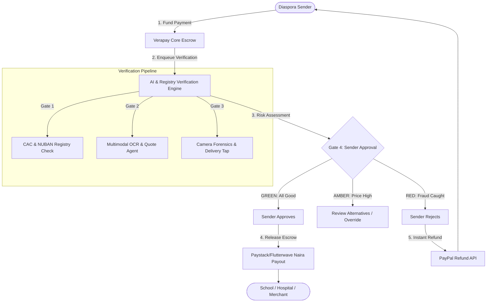

# Verapay: Functional Requirements Document (FRD)
**System Specification & Technical Requirements | Version 2.0**

---

## 1. Document Control & Overview

| Attribute | Specification |
| :--- | :--- |
| **System Name** | **Verapay Core Platform** (*"Verify, then release."*) |
| **Document Type** | Functional Requirements Document (FRD) |
| **Version** | 2.0 (Hackathon MVP & Production Blueprint) |
| **Audience** | Frontend Engineers, Backend Engineers, QA Engineers, System Architects |
| **Primary Rails** | Sender Funding: PayPal Checkout &bull; Payout Settlement: Paystack / Flutterwave NIP Rails |

---

## 2. System Architecture & High-Level Flow

Verapay is an escrow orchestration and automated fraud-prevention layer positioned between international payment rails (PayPal) and local Nigerian banking infrastructure (NIP NUBAN transfers).



---

## 3. User Roles & Permissions Matrix

| Role | Description | Key Capabilities |
| :--- | :--- | :--- |
| **`DIASPORA_SENDER`** | Senders residing abroad (UK, US, CA) funding payments. | Fund escrow, view AI risk signals, approve/reject payouts, create family groups, manage project milestones. |
| **`FAMILY_MEMBER`** | Dependents or relatives in Nigeria. | View family transparent ledger, upload tuition/medical bills, tap "Item Received" for consumer goods. |
| **`CONTRACTOR`** | Site foremen, builders, or vendors in Nigeria. | Submit milestone completion claims, capture live in-app photos, execute 15-second surprise video challenge. |
| **`FIELD_SURVEYOR`** | Certified third-party professional inspector. | Perform on-site structural/land inspections, submit verified independent audit reports. |
| **`VERAPAY_OPERATOR`** | Human compliance and triage analyst. | Review Amber-flagged transactions for Verapay Plus users, mediate stalled project disputes. |

---

## 4. Functional Requirements Specification

### 4.1. Authentication, KYC & Plan Management (FR-AUTH / FR-PLAN)

#### `FR-AUTH-01`: Multi-Region Identity & Onboarding
* **Description:** Senders register using email, Google OAuth, or PayPal login. International phone numbers (UK +44, US/CA +1) require SMS OTP verification.
* **Nigerian Recipients/Contractors:** Register via phone number (+234) with SMS OTP. Optional BVN (Bank Verification Number) inquiry via Paystack to confirm legal identity.

#### `FR-PLAN-01`: Plan Assignment & Billing Logic
* **Basic (Pay-As-You-Go):** $0 monthly fee. System applies 1.5% transaction surcharge ($1.00 min, $20.00 max cap) at checkout.
* **Verapay Plus ($9.99/mo):**
  * Recurring monthly subscription billed via PayPal Subscriptions API.
  * System tracks monthly cumulative volume: 0% transaction fee up to $1,000/month; 1.5% fee applied on incremental spend.
  * Unlocks Family Group workspace, automated recurring bills, Shared Pots, and <4-hour human triage on Amber alerts.
* **Verapay Projects (2% per stage):**
  * Project creation is free; escrow funding includes a 2% verification and orchestration fee billed *strictly upon milestone sign-off*.
  * If a milestone is rejected and refunded, the 2% fee is completely waived/refunded.

---

### 4.2. Escrow & Money Movement Engine (FR-ESCROW)

#### `FR-ESCROW-01`: PayPal Inbound Escrow Funding
* Senders initiate payment via PayPal Checkout.
* Funds are captured into a secure merchant escrow holding balance or held as an authorization (configurable via `ESCROW_HOLD_MODE = CAPTURE_AND_HOLD`).
* Transaction transitions to `ESCROW_HELD`. Funds cannot be touched by recipient or sender until Gate 4 resolution.

#### `FR-ESCROW-02`: Naira Payout Execution
* Upon sender approval (`ACTION_APPROVE`), the system triggers Paystack/Flutterwave Transfer API:
  * Generates Transfer Recipient using verified NUBAN account number and bank code.
  * Initiates Naira transfer at live guaranteed FX rate.
  * Webhook listener monitors `transfer.success`. Upon confirmation, transaction status transitions to `COMPLETED`.

#### `FR-ESCROW-03`: 1-Click Automated Refund
* If the sender taps `ACTION_REFUND` (or verification triggers automated red-fraud cancellation):
  * System calls PayPal Refund API (`v2/payments/captures/{capture_id}/refund`).
  * 100% of escrowed principal is credited back to sender’s PayPal account/card.
  * Transaction status transitions to `REFUNDED`.

---

### 4.3. The 4-Step Verification Engine (FR-VERIFY)

```
[Inbound Escrow Funded]
         │
         ▼
[Gate 1: Payee Reality Check] ──(Fails)──► [RED Alert: Fake Payee] ──► [Instant Refund]
         │ (Passes)
         ▼
[Gate 2: Bill Honesty & Quotes] ──(Padded)──► [AMBER Alert: Padded Price]
         │ (Passes)                                     │ (Sender can switch supplier)
         ▼                                              ▼
[Gate 3: Ground-Truth Proof] ────(Reused)──► [RED Alert: Fake Proof] ──► [Instant Refund]
         │ (Passes)
         ▼
[Gate 4: Sender Approval Screen] ──(Sender Taps Yes)──► [Release Payout to NUBAN]
```

#### `FR-VER-01`: Gate 1 – Payee Legitimacy & Registry Check
* **Corporate Registry Check:** Query Corporate Affairs Commission (CAC) API using company registration number or registered business name.
* **NUBAN Name Match:** Execute NIP account name resolution via Paystack (`GET /bank/resolve?account_number=...&bank_code=...`).
* **Match Rule:** Levenshtein similarity between CAC entity name and NUBAN bank account holder name must exceed 85%. If mismatch detected, flag `RED_PAYEE_MISMATCH`.
* **Unregistered Small Merchants:** For informal market vendors (sand, timber, blockmakers):
  * Verify seller’s personal NUBAN account name.
  * Record verified merchant phone number and physical shop coordinates.
  * Enforce **Strict Pay-on-Delivery Rule**: Funds remain locked until on-site delivery is confirmed by family/foreman.

#### `FR-VER-02`: Gate 2 – Bill Honesty & Document OCR
* Multimodal LLM (Gemini 1.5/2.0 Flash) extracts structured JSON:
  * Student / Patient Name, Institution Name, Invoice Number, Issue Date, Due Date.
  * Line items: Description, Quantity, Unit Rate, Total Amount.
* **Duplicate Detection:** Calculates perceptual hash (dHash) and SHA-256 text fingerprint. If invoice hash matches existing record in `invoice_archive`, flag `RED_DUPLICATE_INVOICE`.
* **Arithmetic Validation:** System computes `SUM(line_items) == subtotal` and `subtotal + tax == total`. Mismatches trigger `AMBER_ARITHMETIC_ERROR`.

#### `FR-VER-03`: Gate 2B – Autonomous Quote Agent (Anti-Padding)
* Triggered on construction materials (cement, granite, blocks, rebar, roofing sheets).
* System extracts material specifications and location (e.g., *500 bags Dangote 42.5R Cement, Ibadan*).
* Quote Agent queries cached regional commodity index and 2–3 nearby merchant price feeds.
* **Threshold Logic:**
  * If contractor quote <= 108% of market average: `PRICE_FAIR` (Green).
  * If contractor quote > 108% and <= 125%: `PRICE_HIGH` (Amber: recommends alternative local suppliers).
  * If contractor quote > 125%: `PRICE_EXTORTION` (Amber/Red: requires contractor justification).

#### `FR-VER-04`: Gate 3 – Ground-Truth Execution Proof
* **Category A: Tuition, Medical, Rent:** Direct payment to CAC-verified institution; system polls for official institutional e-receipt or confirmation letter and attaches to transaction record.
* **Category B: Consumer Goods (Appliances, Provisions):** Escrow is held until the local recipient taps `CONFIRM_DELIVERY` inside the mobile app. Geolocation must be within 5km of delivery address.
* **Category C: Construction & Capital Milestones:**
  1. **In-App Camera Capture:** Media must be recorded directly via WebRTC viewfinder. Standard `<input type="file">` file uploads are disabled.
  2. **Metadata Tamper Check:** Device GPS, altitude, compass bearing, and network timestamp embedded into image EXIF and cryptographically signed.
  3. **Visual Perceptual Hashing:** Checks image against database of historical project photos to prevent submitting last month’s photos.
  4. **Surprise 15-Second Video Prompt:** Random challenge issued: *"Record a continuous 15-second pan of the north wall showing code #4829 on a piece of paper."*
  5. **Surveyor Audit Escalation:** For stages > $2,000, sender can dispatch a certified Verapay surveyor for physical sign-off.

#### `FR-VER-05`: Gate 4 – Sender Approval Interface (Traffic Light UI)
* System synthesizes all signals into a clean mobile card:
  * 🟢 **GREEN:** Payee CAC confirmed, invoice price within 5% of benchmark, proof verified. Single button: `[ Approve & Pay $XXX ]`.
  * 🟡 **AMBER:** Discrepancy detected (e.g., cement quoted 18% above market, or blurry proof). Options: `[ View Cheaper Suppliers ]`, `[ Request Human Review (Plus) ]`, `[ Override & Pay ]`.
  * 🔴 **RED:** Proof failed (reused image, name mismatch, faked bill). Escrow remains locked. Option: `[ 1-Click Instant Refund ]`.

---

### 4.4. Subscription & Collaboration Features (FR-PLUS / FR-PROJ)

#### `FR-PLUS-01`: Automated Recurring Payments
* Senders configure monthly schedule (e.g., Mom's allowance on 1st of month, Dad's medication on 15th).
* 48 hours prior to execution, Verapay prompts provider/family for updated bill or confirms fixed schedule.
* Verapay runs Gate 1 and Gate 2 checks. If Green, sender receives a notification: *"November allowance verified. Executing in 12 hours unless cancelled."*

#### `FR-PLUS-02`: Family Group Workspace
* Sender creates a `FamilyGroup` (e.g., *"The Balogun Family"*).
* Invites siblings abroad (co-funders) and family members in Nigeria (beneficiaries).
* Shared real-time ledger displays all past and pending payments, itemized receipts, and verification reports.

#### `FR-PLUS-03`: Shared Pot (Multi-Sibling Pooling)
* Senders initiate a Shared Pot (e.g., *"Dad's Eye Surgery - $1,200"*).
* Multiple siblings contribute varying amounts ($400, $500, $300) via their respective PayPal accounts.
* Funds are held in aggregate escrow until the 100% threshold is reached.
* Upon full funding, Verapay executes Gate 1–3 verification and pays the hospital directly.

#### `FR-PROJ-01`: Stage-by-Stage Construction Sequencing
* Projects follow standardized or custom milestone paths:
  1. *Stage 1: Site Clearing & Foundation ($2,500)*
  2. *Stage 2: Blockwork to Lintel Level ($3,200)*
  3. *Stage 3: Roof Truss & Covering ($4,000)*
  4. *Stage 4: Plastering, Electrical & Plumbing ($3,000)*
  5. *Stage 5: Finishing, Tiling & Painting ($2,800)*
* Escrow is funded stage-by-stage. Stage N+1 cannot be funded or started until Stage N proof is approved.
* Senders receive an automated weekly progress briefing written in plain English.

---

## 5. Non-Functional Requirements (NFR)

| ID | Category | Requirement Specification |
| :--- | :--- | :--- |
| **NFR-SEC-01** | **Data Security** | All data in transit encrypted via TLS 1.3. Sensitive NUBAN and identity fields encrypted at rest using AES-256. |
| **NFR-PERF-01** | **Verification Latency** | Automated OCR and CAC verification must complete in `< 45 seconds`. End-to-end sender approval card ready in `< 3 minutes`. |
| **NFR-REL-01** | **Escrow Idempotency** | All payout and refund API calls must enforce UUID-based idempotency keys to guarantee zero double-disbursements. |
| **NFR-NET-01** | **Nigerian Network Resilience** | Mobile web application must operate on high-latency 3G networks (down to 256 kbps). In-app photo uploads must implement client-side image compression (JPEG quality 75%, max dimension 1920px) before transit. |
| **NFR-AUD-01** | **Audit Trail** | Every verification signal, EXIF coordinate, OCR token, and sender click logged to an immutable append-only audit ledger for compliance. |

---

## 6. Verification Traceability Matrix

| Business Goal | Functional Requirement | Test Acceptance Criteria |
| :--- | :--- | :--- |
| Eliminate Diversion | `FR-VER-01`, `FR-ESCROW-02` | 100% of disbursements route to verified NUBAN account matching registered provider name. |
| Stop Price Padding | `FR-VER-03` | Padded cement quotes >10% over local index reliably trigger Amber warning with alternative supplier recommendations. |
| Catch Reused Photos | `FR-VER-04`, `FR-VIS-01` | Re-submitting an existing project image triggers Red alert with perceptual hash match score > 92%. |
| Guarantee Zero Fund Loss | `FR-ESCROW-03` | Senders can trigger an immediate 100% refund on any rejected or unverified transaction. |
